<!-- VEYTRIX | CINEMATIC 3D ENGINEERING README -->

<div align="center">


<a href="https://github.com/SyedRaqi/Veytrix">
  
</a>

<br/>

<a href="#capabilities"></a>
&nbsp;
<a href="#stack"></a>
&nbsp;
<a href="#start"></a>
&nbsp;
<a href="#disclaimer"></a>

<br/><br/>


</div>

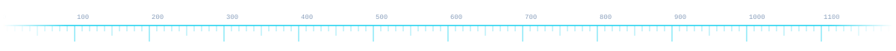

<a name="overview"></a>


> **VEYTRIX is an automotive engineering and simulation platform that brings vehicle design, component configuration, material intelligence, performance analysis and optimization into one connected workspace.**

Build, simulate and refine next-generation vehicles with engineering-driven insights.

VEYTRIX pairs a React and TypeScript interface with a Flask API for engineering concept calculations, which are explicitly labeled as such.

<div align="center">
</div>

<a name="capabilities"></a>

### Capabilities

- 🚗 **Vehicle design and configuration**
- 🧊 **3D vehicle visualization**
- 🔩 **Engineering component library**
- 🧪 **Material intelligence**
- 🌬️ **Aerodynamics and thermal analysis**
- 🏗️ **Structural and vehicle dynamics calculations**
- ⚡ **Performance and energy analysis**
- 🎯 **Engineering optimization**
- 📊 **Analytics and engineering reports**

> 🎨 **About the pictures:** every illustration in this README is a designed visual, not a screenshot and not simulation output. The car, parts, charts and numbers shown are sample content created to convey the idea of each capability.

<a name="design"></a>


<div align="center">
</div>

<a name="viz"></a>


<div align="center">
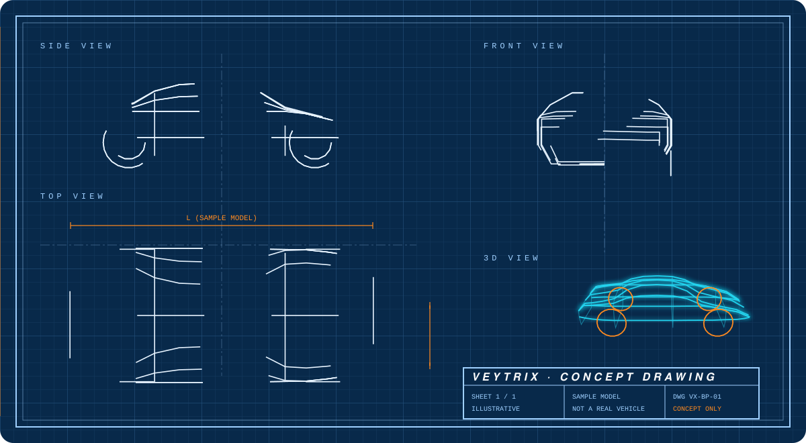
</div>

<a name="parts"></a>


<div align="center">
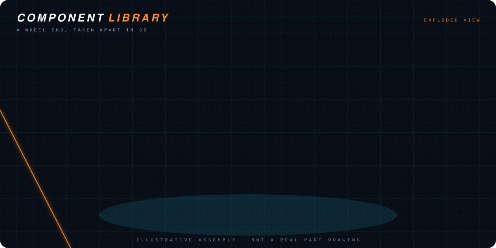
</div>

<a name="materials"></a>


<div align="center">
</div>

<a name="aero"></a>


<div align="center">
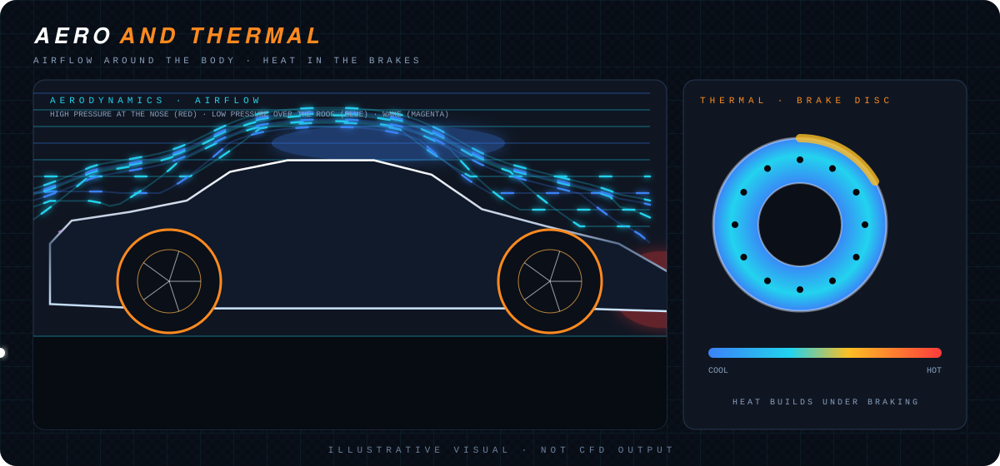
</div>

<a name="structure"></a>


<div align="center">
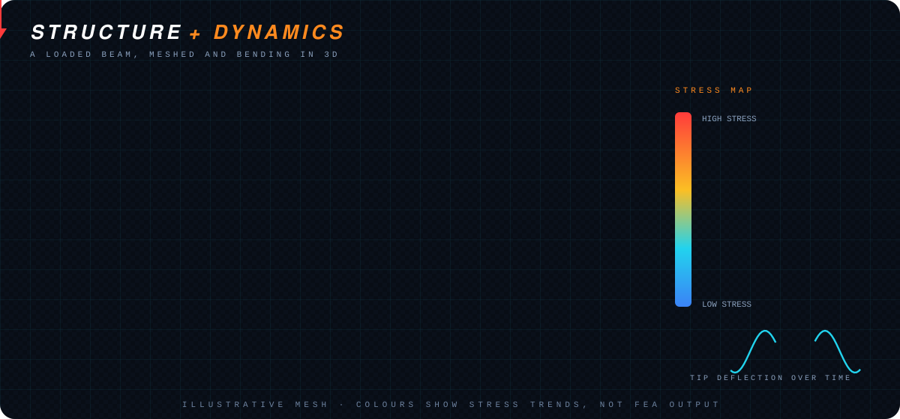
</div>

<div align="center">
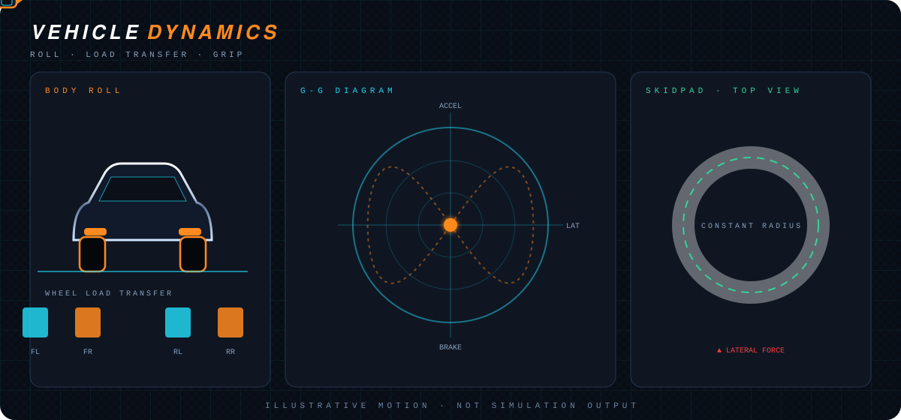
</div>

<a name="energy"></a>


<div align="center">
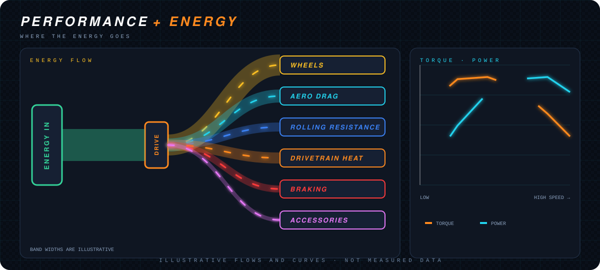
</div>

<a name="optimize"></a>


<div align="center">
</div>

<a name="reports"></a>


<div align="center">
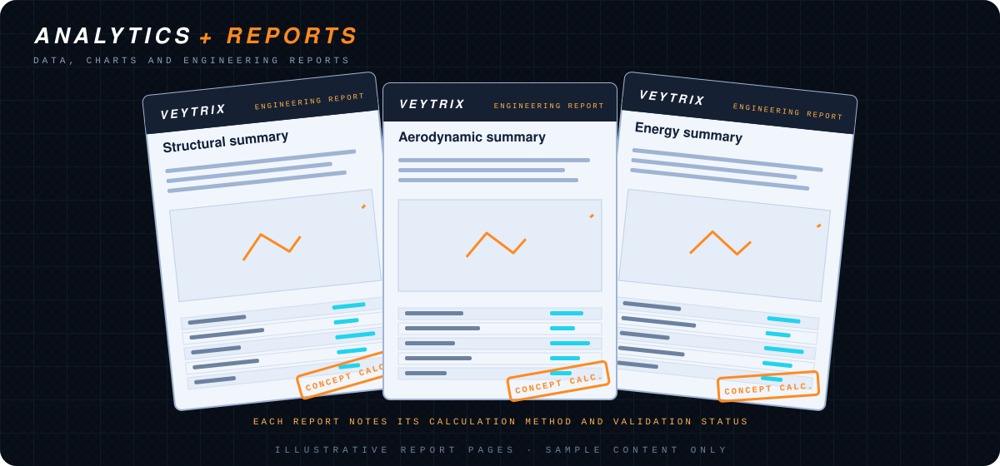
</div>

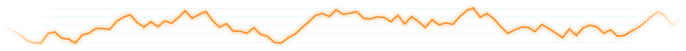

<a name="stack"></a>


<div align="center">
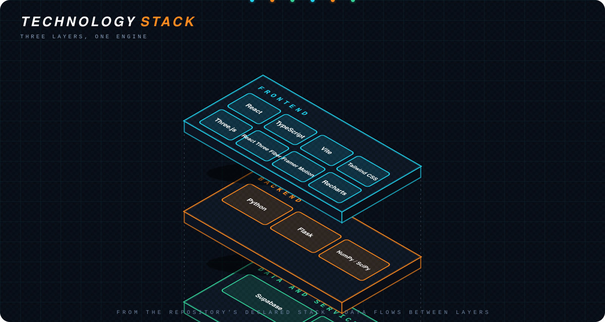
</div>

<br/>

| Layer | Technologies |
| :--- | :--- |
| 🖥️ **Frontend** | React, TypeScript, Vite, Tailwind CSS, Three.js, React Three Fiber, Framer Motion, Recharts |
| ⚙️ **Backend** | Python, Flask, NumPy / SciPy |
| 🗄️ **Database and services** | Supabase, PostgreSQL |

<a name="garage"></a>


<div align="center">
</div>

<br/>

| Folder | Role |
| :--- | :--- |
| `.github/` | GitHub configuration and workflows |
| `backend/` | The Flask API and engineering calculations |
| `database/` | Database files |
| `docs/` | Documentation |
| `frontend/` | The React and TypeScript app |
| `scripts/` | Helper scripts |
| `supabase/` | Supabase project files |

<a name="start"></a>


<div align="center">
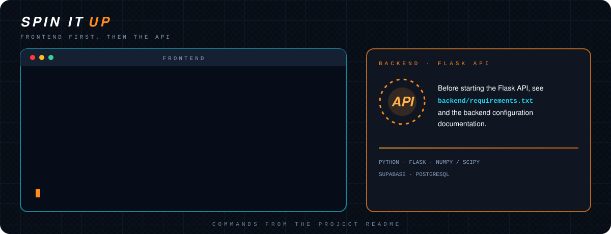
</div>

<br/>

**Frontend**

```bash
cd frontend
npm install
npm run dev
```

**Production build**

```bash
npm run build
```

**Backend**

Refer to `backend/requirements.txt` and the backend configuration documentation before starting the Flask API.

<a name="disclaimer"></a>


<div align="center">
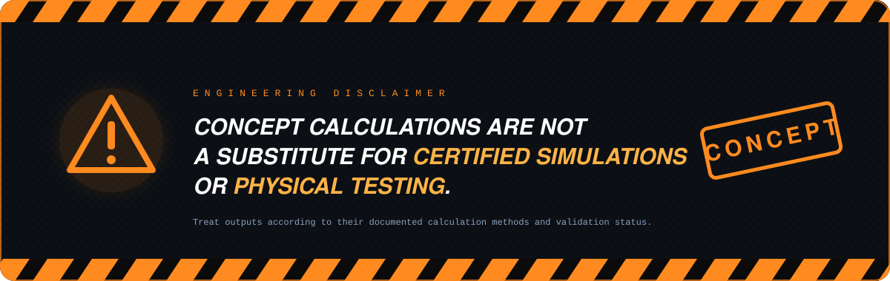
</div>

<br/>

> ⚠️ **Please read this.** VEYTRIX provides engineering concept calculations. They are not a substitute for certified engineering simulations or physical testing. Treat outputs according to their documented calculation methods and validation status.

<a name="license"></a>


Released under the [Unlicense](LICENSE). Take it, remix it, make it your own.

<div align="center">


**VEYTRIX** · Built by [Syed Raqi](https://github.com/SyedRaqi) · [⭐ Star the repo](https://github.com/SyedRaqi/Veytrix)

<sub>Engineering intelligence. Design. Simulate. Refine.</sub>

</div>
